# The editor step by step

How to build a new feature of the assistant without writing YAML: from a sentence the assistant did not understand, through a new topic with data, a test and saving, to a command of Home Assistant. The names of buttons and fields are those of the editor, and the pictures come from the demo with a made-up home.

## Before you start {#before}

The editor is a panel in Home Assistant where you build what the assistant can do: topics of questions with the
data of your home, and commands that Home Assistant recognizes by itself. No YAML is needed: every element has a
form, and `router.yaml` changes only when you save.

- **Where:** the sidebar → <b class="ui">Assist Router editor</b>. Only administrators see it. When it is hidden
  (the option <b class="ui">Show the editor in the sidebar</b> in Settings → Devices & services → Assist Router → Configure),
  it opens at `/assist-router-editor`.
- **Without Home Assistant:** `make demo` in the repository opens the editor on the example
  file with a made-up home. Nothing is saved there. All the pictures below come from it.
- **Draft:** every change goes to a draft kept in Home Assistant. A draft changes nothing and waits,
  also after the page is closed. Undo: <kbd>Ctrl</kbd>+<kbd>Z</kbd>, redo: <kbd>Ctrl</kbd>+<kbd>Shift</kbd>+<kbd>Z</kbd>,
  save: <kbd>Ctrl</kbd>+<kbd>S</kbd>.

!!! note

    The example that runs through the whole guide: people at home ask "When do the bins go out?" and the
    assistant does not understand. In a few steps a topic `bins` answers from the bin collection sensor, and a
    command "light up {name}" is added to Home Assistant.

## The screen of the editor {#screen}

The screen has three columns. Drag a border to change a width; a double click gives the first one back.

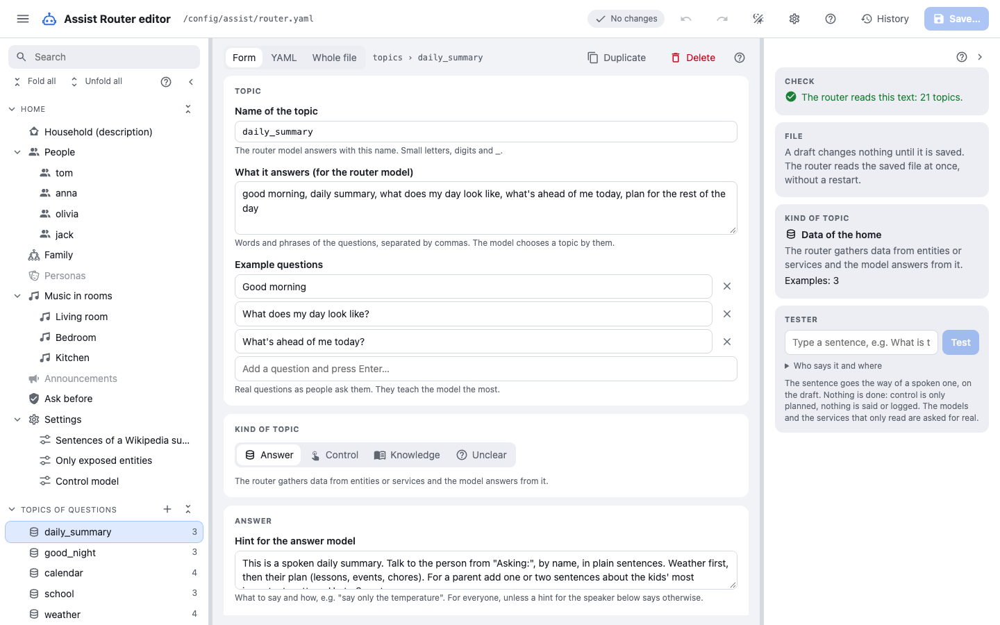{ .shot loading=lazy }
/// caption
The topic `daily_summary` open in its form.
///

- **Left, the tree of the file:**
  - <b class="ui">Home</b>: the household, <b class="ui">People</b>, <b class="ui">Family</b>, <b class="ui">Personas</b>, music, announcements, confirmation and
    <b class="ui">Settings</b> (greyed parts are not in the file yet and can be filled in);
  - <b class="ui">Topics of questions</b> with a <b class="ui">+</b> button, and <b class="ui">Special</b> (control, knowledge, unclear, other);
  - <b class="ui">Learning</b>: <b class="ui">Unrecognized sentences</b> and <b class="ui">Test set</b>;
  - <b class="ui">Commands of Home Assistant</b>: the files of `custom_sentences`, with a <b class="ui">+</b> button.

  The number beside a topic is its number of example questions. <b class="ui">Search</b> narrows the tree.
- **Middle:** the tabs <b class="ui">Form</b>, <b class="ui">YAML</b> (this element only, with its comments) and
  <b class="ui">Whole file</b>; on the right <b class="ui">Duplicate</b> and <b class="ui">Delete</b>.
- **Right:** <b class="ui">Check</b> (whether the router reads the text and how many topics it has), <b class="ui">File</b>
  (the state of the draft), <b class="ui">Kind of topic</b> and the <b class="ui">Tester</b>.
- **Top bar:** the state (<b class="ui">No changes</b> or <b class="ui">Draft saved</b>), undo and redo, <b class="ui">Discard draft</b>,
  light or dark look, **⚙** (a small window: <b class="ui">Look</b>, <b class="ui">Language</b>, <b class="ui">Tour of the editor</b> and
  <b class="ui">Lessons</b>, [chapter](#lessons)), **?** (this guide, in a new
  tab), <b class="ui">History</b> and <b class="ui">Save…</b>.
- **Small ?** above the tree, the middle and the right column: a small window that says what that part does, without
  leaving the editor (Esc or a click beside it closes it); <b class="ui">Show me step by step: {name}</b> starts the lesson of that place, *More in the guide* at its bottom opens the chapter about
  it, in the middle the one about what you chose (a topic, the tests, learning…). Only the ? of the top bar opens this
  guide at once.
- **The address** of the page names the chosen node (`…#/topics/weather`): a copied link or a reload opens the editor
  on it once the file has loaded.

## Where ideas come from: unrecognized sentences {#learning}

The best new features are the ones people at home already asked for. Click <b class="ui">Learning</b> →
<b class="ui">Unrecognized sentences</b>.

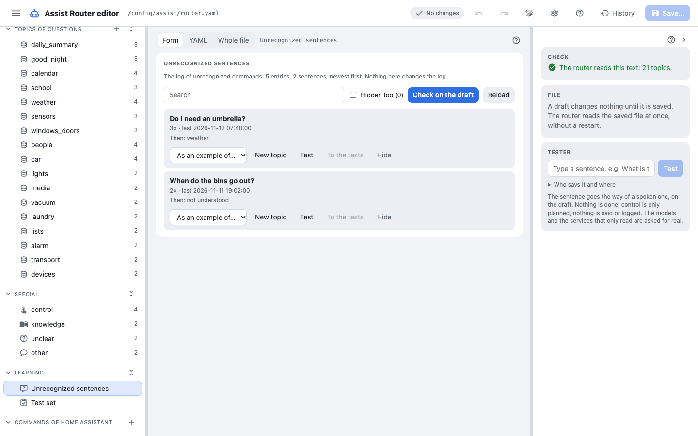{ .shot loading=lazy }
/// caption
Sentences of the log, grouped: how often they were said, when last, and where they went then.
///

- <b class="ui">Check on the draft</b> shows where each sentence would go now.
- Beside each sentence: <b class="ui">As an example of…</b> (adds it to an existing topic), <b class="ui">New topic</b>, <b class="ui">Test</b>
  (puts it into the tester), <b class="ui">To the tests</b> and <b class="ui">Hide</b>. Hiding works in the editor only; the log stays
  as it is.

In the example, "When do the bins go out?" went to "not understood". Click <b class="ui">New topic</b> beside it.

## A new topic {#topic}

<b class="ui">New topic</b> makes a topic with this sentence as its description and first example and opens its form at
once. An empty topic is also added with <b class="ui">+</b> beside <b class="ui">Topics of questions</b>.

1. <b class="ui">Name of the topic</b>: a short key of lowercase letters, digits and `_`, e.g. `bins`.
   The router model answers with this name. Renaming changes the key in the file.
2. <b class="ui">What it answers (for the router model)</b>: words and phrases of the questions, separated by commas, e.g.
   "bins, bin lorry, rubbish collection, recycling, plastic, garden waste". The model chooses the topic by them, so
   write the different ways people talk about the same thing.
3. <b class="ui">Example questions</b>: type a question in <b class="ui">Add a question and press Enter…</b> and press <kbd>Enter</kbd>.
   Add a few real questions, the way they are asked at home: they teach the model most.

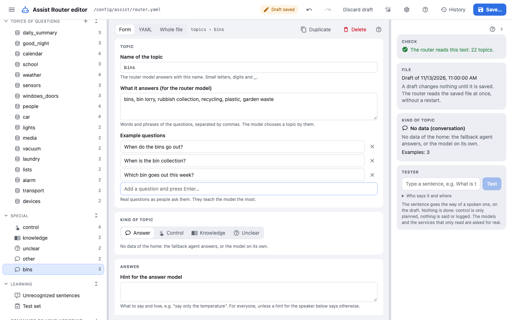{ .shot loading=lazy }
/// caption
The new topic with its name, description and three examples. Without data its <b class="ui">Kind of topic</b> is still <b class="ui">No data (conversation)</b>.
///

The <b class="ui">Kind of topic</b> is set with <b class="ui">Answer</b>, <b class="ui">Control</b>, <b class="ui">Knowledge</b> and <b class="ui">Unclear</b>. A question
about the data of the home is an <b class="ui">Answer</b>. The right column shows how the router sees the topic: once data is
added, it changes to <b class="ui">Data of the home</b>.

Below, under <b class="ui">Answer</b>, are <b class="ui">Hint for the answer model</b> (e.g. "say the day of the week and the kind of
bin"), <b class="ui">Hints for who asks (0)</b> (the number says how many there are), <b class="ui">Longest answer (tokens)</b> and <b class="ui">About who asks</b>.

## The data of a topic {#data}

A topic answers from the data you point it to. Scroll to <b class="ui">Data</b>.

1. <b class="ui">Entities</b> → <b class="ui">Entity patterns</b>: type a pattern in <b class="ui">Add…</b> and press <kbd>Enter</kbd>, e.g.
   `sensor.bin_collection*`. The star is any text. The green number beside it says how many entities the
   pattern finds now; zero is marked in orange.
2. Under the patterns: <b class="ui">Matching entities: 1; lines for the model: 1.</b> Open <b class="ui">What the model gets (lines: 1)</b>
   to see exactly the lines that go to the model.
3. <b class="ui">Attributes</b> → <b class="ui">Entities whose attributes go to the model</b>: patterns of entities (not names of
   attributes) whose attributes go to the model, e.g. the same `sensor.bin_collection*`, so the model knows
   the kind of bin.
4. <b class="ui">Services</b> → <b class="ui">Add a service</b>: data from a service that returns it, e.g. `calendar.get_events`.
   Services are not called while you type; only <b class="ui">Fetch the data now</b> calls them, and only services that just
   return data.

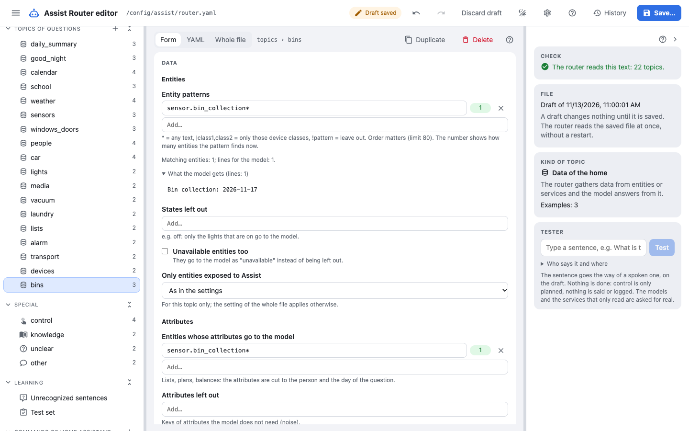{ .shot loading=lazy }
/// caption
The pattern finds 1 entity and the preview shows the line for the model. The kind of topic is now <b class="ui">Data of the home</b>.
///

!!! tip

    A 0 beside a pattern is the most common mistake: the pattern fits no entity (a typo, another domain),
    or a name of an attribute was typed in <b class="ui">Entities whose attributes go to the model</b> instead of a pattern of
    entities.

## The tester {#tester}

The tester sends a sentence along the way of a spoken one, on the draft, without saving. Type a sentence in the
right column (<b class="ui">Tester</b>) and click <b class="ui">Test</b>.

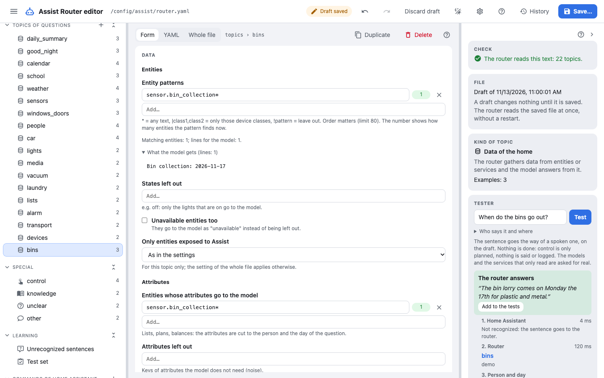{ .shot loading=lazy }
/// caption
<b class="ui">The router answers</b>: the topic `bins` and the model's answer; the steps of the way below.
///

1. <b class="ui">1. Home Assistant</b>: whether HA recognizes the sentence itself. A recognized one ends there.
2. <b class="ui">2. Router</b>: the topic chosen (a click opens it in the form), the model and the time.
3. <b class="ui">3. Person and day</b> taken from the sentence.
4. <b class="ui">4. Data</b>: the states, attributes and services the model got.
5. <b class="ui">5. Answer</b> of the model with its time; the <b class="ui">Prompt</b> can be opened.

<b class="ui">Who says it and where</b> sets the speaker, persona, room and a comparison with the saved file. The tester does
nothing in the home: control is only planned, nothing is said or logged. The models and the services that only read
are asked for real.

When the router chooses the wrong topic, improve <b class="ui">What it answers (for the router model)</b> or add an example,
and test again.

## The test set {#tests}

A sentence that works is worth keeping, so the next change does not break it. In the tester click
<b class="ui">Add to the tests</b>. The set is in <b class="ui">Learning</b> → <b class="ui">Test set</b> (the file
`assist/router_tests.yaml`, saved at once with a `.bak` copy).

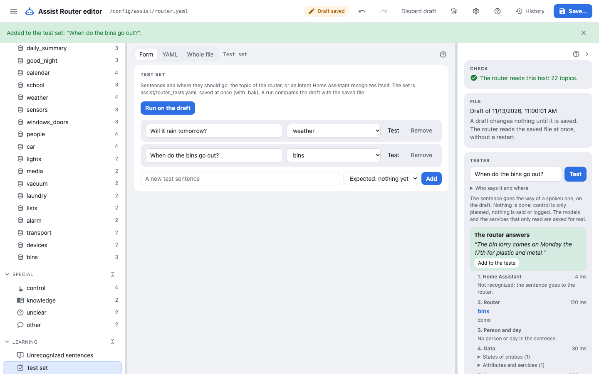{ .shot loading=lazy }
/// caption
Each test is a sentence and where it should go: a topic of the router or an intent Home Assistant recognizes by itself.
///

- <b class="ui">Run on the draft</b> checks every sentence on the draft and on the saved file.
- A new test: <b class="ui">A new test sentence</b>, the target from the list (a topic or <b class="ui">Home Assistant itself (intent)</b>)
  and <b class="ui">Add</b>.
- <b class="ui">Test</b> puts the sentence into the tester, <b class="ui">Delete</b> removes the test.

## Saving {#save}

Click <b class="ui">Save…</b> at the top. The <b class="ui">Save router.yaml</b> window shows everything before the file changes:

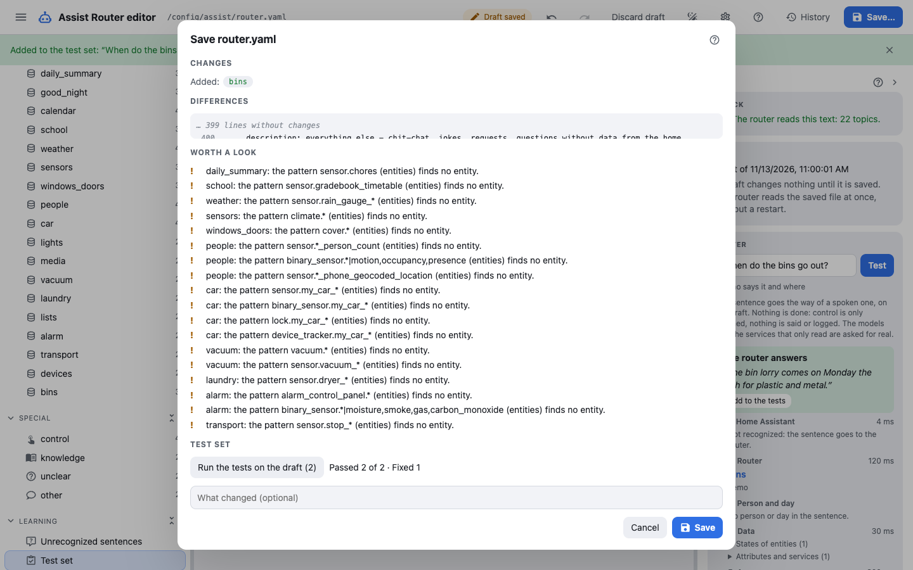{ .shot loading=lazy }
/// caption
Changes, differences, warnings and the result of the tests on the draft.
///

- <b class="ui">Changes</b>: elements added, removed and changed; <b class="ui">Differences</b>: the changed lines of the file.
- <b class="ui">Worth a look</b>: patterns that find nothing, services that may change something or do not exist, topics
  without a description or examples. Warnings do not stop saving. The example file has warnings for entities the
  made-up home does not have.
- <b class="ui">Test set</b>: <b class="ui">Run the tests on the draft (2)</b> shows how many tests passed and how many the change fixed
  or broke.
- <b class="ui">What changed (optional)</b>: a note for the history. Then <b class="ui">Save</b>.

The editor does not save a text the router cannot read. The router reads the saved file at once, without a
restart, and the previous one stays as `router.yaml.bak`.

## History and undo {#history}

<b class="ui">History</b> at the top opens <b class="ui">History of saves</b>: the last 30 saves with their date, note and author. A
chosen version shows its differences from the current file.

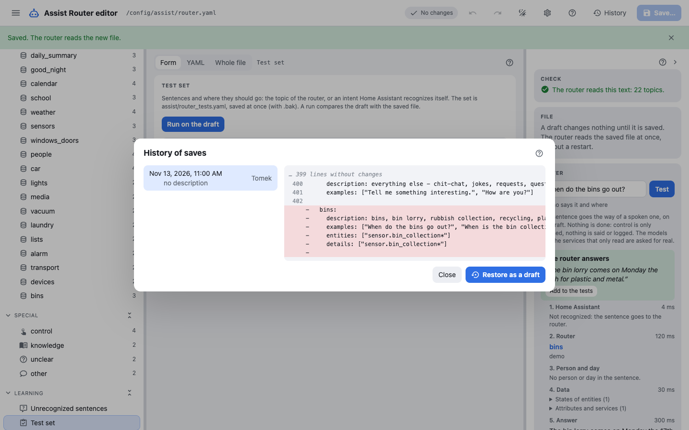{ .shot loading=lazy }
/// caption
The version before the save: restoring it would remove the topic `bins` (lines in red).
///

<b class="ui">Restore as a draft</b> loads that version into the draft; the file changes only when you save. Before saving,
<b class="ui">Discard draft</b> throws all changes away.

## A command of Home Assistant {#command}

Not every sentence needs the router. Home Assistant recognizes simple commands by itself, faster and without a
model, when they are added to `custom_sentences`. Those files are in <b class="ui">Commands of Home Assistant</b>.

1. <b class="ui">+</b> beside <b class="ui">Commands of Home Assistant</b>. The window <b class="ui">New file of commands</b> asks for its name
   (letters, digits, _ and -), e.g. `lamps.yaml`; <b class="ui">Create</b> or <kbd>Enter</kbd> makes it, <b class="ui">Cancel</b> or <kbd>Esc</kbd> does not.
2. Type an intent in <b class="ui">Intent, e.g. HassTurnOn</b> and click <b class="ui">Add an intent</b>. The built-in intents of Home
   Assistant (e.g. `HassTurnOn`, `HassTurnOff`) work at once.
3. Under <b class="ui">Sentences 1</b>, type a sentence in <b class="ui">Add a sentence, e.g. wake up {name}</b> and press <kbd>Enter</kbd>,
   e.g. `light up {name}`. `{name}` is the name of a device or an area, `(a|b)`
   one of the words, `[a]` an optional word. <b class="ui">Add a group of sentences</b> starts another group.
4. <b class="ui">Answer (responses → default)</b>: what Home Assistant says, e.g. "It is on.". Empty = the answer of Home
   Assistant.
5. <b class="ui">Save and reload</b>: checks every sentence as Home Assistant does, saves the file with a `.bak` copy
   and reloads the sentences, so the command works at once, without a restart.
6. <b class="ui">What Home Assistant recognizes</b>: type a sentence, e.g. "light up the living room", and click <b class="ui">Test</b>.
   Nothing is done: Home Assistant only says what it would recognize.

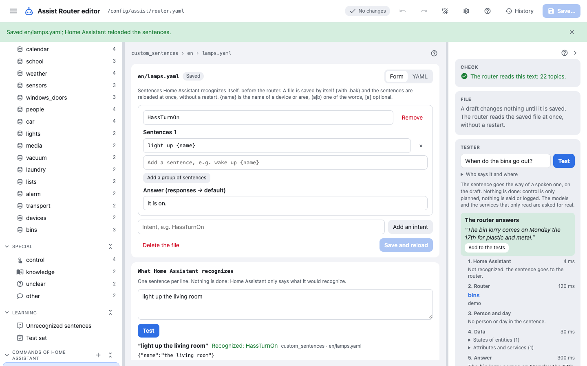{ .shot loading=lazy }
/// caption
The file `en/lamps.yaml` saved and reloaded; “light up the living room” → <b class="ui">Recognized: HassTurnOn</b> with `name` = the living room.
///

!!! tip

    An intent Home Assistant cannot run (not built in and without an `intent_script`) is
    marked: the sentence is recognized, but nothing happens.

A file of commands is saved on its own, not with the draft of `router.yaml`. <b class="ui">Delete the file</b>
keeps it as `.bak`.

### Sentence syntax {#syntax}

One line can cover many ways of saying the same thing. The lesson <b class="ui">Sentence syntax</b> shows it in the
editor.

| Written | Meaning | Example |
| --- | --- | --- |
| `(a|b)` | one of the words | `(turn on|switch on) {name}` |
| `[a]` | an optional word | `[please] turn on {name}` |
| `{name}`, `{area}`, `{floor}` | a device (an entity exposed to Assist), an area, a floor; Home Assistant fills them by itself | `turn off the light in {area}` |
| `{list}` | your own list from `lists:` or a list of the intent, e.g. `{brightness}` | `set {name} to {brightness}` |
| `<rule>` | a fragment from `expansion_rules:`, written once, used in many sentences | `<turn_on> {name}` |

<b class="ui">Add a group of sentences</b> starts another group. A group is sentences with the same extra settings:
fixed `slots:` (e.g. `domain: light`) or `requires_context:` (e.g. only the area of the speaker). The form writes
the sentences; the settings of a group, `lists:` and `expansion_rules:` are typed in the **YAML** view (the form
shows them as "Also: …").

```yaml
language: en
intents:
  HassLightSet:
    data:
      - sentences:
          - "<set> {name} to {colour}"
        slots:
          domain: light
lists:
  colour:
    values:
      - in: "(red|crimson)"
        out: red
      - in: "(blue|navy)"
        out: blue
expansion_rules:
  set: "(set|change|make)"
```

Other kinds of lists: `range:` (numbers, e.g. `from: 0`, `to: 100`) and `wildcard: true` (any text, e.g. an item for
the shopping list). After saving, <b class="ui">What Home Assistant recognizes</b> shows the values of the slots next
to the intent, e.g. `{"name": "desk lamp", "colour": "red"}`, so you see whether the sentence went where it should.

## Tour and lessons {#lessons}

The editor shows you where things are. The **Tour of the editor** starts by itself the first time the editor opens in a
browser: it frames the tree, the + buttons, the middle, the tabs, the right column, the tester, the draft, saving and
the help one at a time, and a bubble says what each part is for and where it is set. <b class="ui">Next</b>,
<b class="ui">Back</b> or the arrows move on, Esc or <b class="ui">Skip</b> ends it. **⚙** → <b class="ui">Tour of the editor</b>
brings it back.

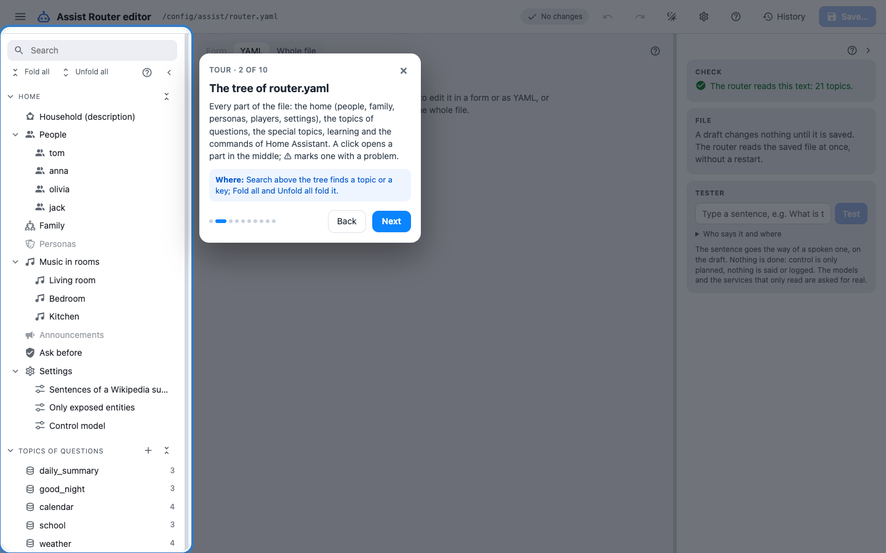{ .shot loading=lazy }
/// caption
Step 2 of the tour: the tree framed, the rest dimmed, a bubble with what it is and where it is set.
///

The **Lessons** (⚙ → <b class="ui">Lessons</b>) are short tasks done step by step. Each one goes where the task is done
(chooses a topic, opens a part of a form), frames one thing at a time, and a step with a button waits for you to
click it, so you do the task while you learn it. <b class="ui">Next</b> on such a step does what the click would.
Nothing is saved until you click <b class="ui">Save</b> yourself.

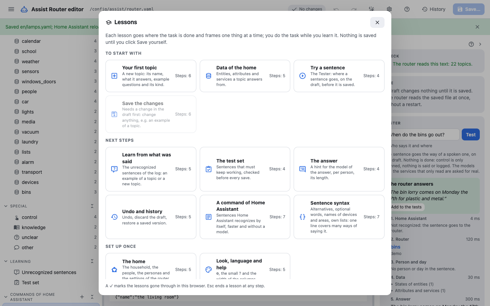{ .shot loading=lazy }
/// caption
The lessons in three groups. A greyed one says what it still needs; ✓ marks the ones gone through in this browser.
///

| Group | Lesson | What it teaches |
| --- | --- | --- |
| <b class="ui">To start with</b> | <b class="ui">Your first topic</b> | + at the topics, name, what it answers, examples, kind ([A new topic](#topic)) |
| | <b class="ui">Data of the home</b> | entity patterns, attributes, services ([The data of a topic](#data)) |
| | <b class="ui">Try a sentence</b> | the tester and the way of a sentence ([The tester](#tester)) |
| | <b class="ui">Save the changes</b> | the window of saving: changes, warnings, tests, description ([Saving](#save)); needs a change in the draft |
| <b class="ui">Next steps</b> | <b class="ui">Learn from what was said</b> | unrecognized sentences ([Where ideas come from](#learning)) |
| | <b class="ui">The test set</b> | a new test, running it on the draft ([The test set](#tests)) |
| | <b class="ui">The answer</b> | hints for the answer model, length, “about who asks” |
| | <b class="ui">Undo and history</b> | undo, discard the draft, restore a version ([History](#history)) |
| | <b class="ui">A command of Home Assistant</b> | a file of commands (made by the lesson when there is none), intent, sentences, saving ([A command](#command)) |
| | <b class="ui">Sentence syntax</b> | (a\|b), [a], {name}/{area}, groups of sentences, an intent with no handler, lists and expansion_rules in YAML, the values of slots ([Syntax](#syntax)); needs a file of commands with an intent |
| <b class="ui">Set up once</b> | <b class="ui">The home</b> | household, people, personas, settings |
| | <b class="ui">Look, language and help</b> | ⚙, the small ?, the width of the columns |

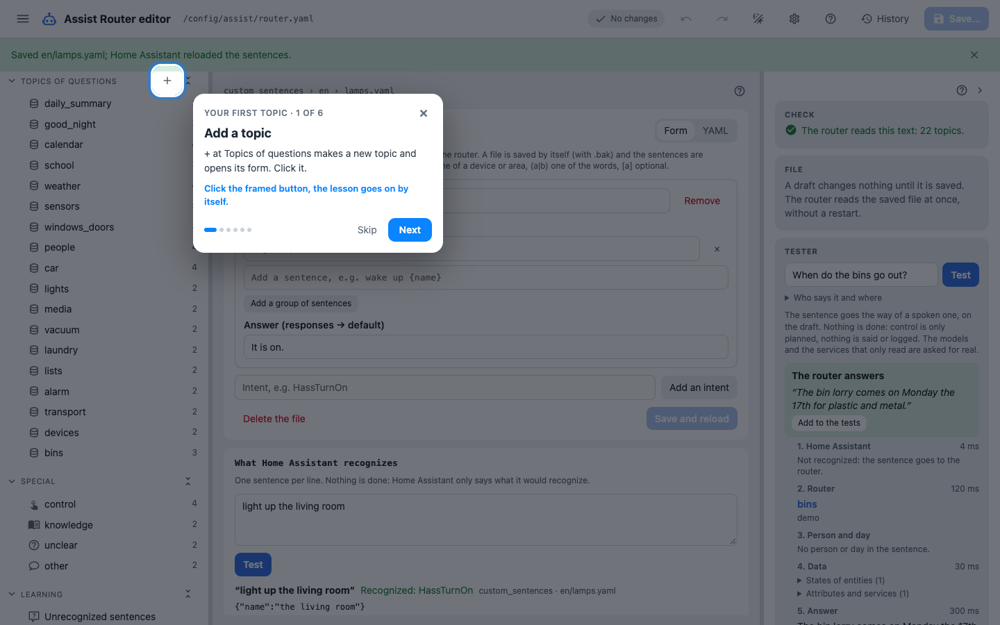{ .shot loading=lazy }
/// caption
The step waits for the framed + to be clicked: the tree scrolled to it by itself, the rest of the screen takes no clicks.
///

The small **?** above each column offers the lesson of that place (<b class="ui">Show me step by step: {name}</b>): your
first topic at the tree, the tester at the right column, in the middle the one about the chosen part.

## All parts of the editor {#editor}

!!! tip

    **Step by step with pictures:** [The Assist Router editor step by
    step](#before) (the beginning of this page) shows on an example how to build a new feature: from an unrecognized sentence, through a new topic with data,
    the tester and saving, to a command of Home Assistant. Every part of the editor is described below.

The integration adds a panel for administrators to the sidebar of Home Assistant:
**Assist Router editor**. The option *Show the editor in the sidebar* (Configure → Settings) takes it
out of the sidebar; it then opens at `/assist-router-editor`. The editor has a light and a dark look: as
Home Assistant by default, and a button in the top bar switches Auto, Light and Dark (the browser remembers it). The **⚙** next to it opens a small
window under it with the same <b class="ui">Look</b> (As in HA / Light / Dark) and the <b class="ui">Language</b> of the editor
(As in HA / Polski / English): Home Assistant decides both until you choose otherwise, so with Home Assistant in English
you can still have the editor in Polish. A choice works at once and this browser remembers it; Esc, a click beside the
window or ⚙ again close it. It edits `router.yaml` in three
columns:

- **the tree** of the file: the home (household, people, family, personas, music,
  announcements, ask before, settings; the parts the file has none of yet are greyed out and can be
  filled in), the topics of questions and the special topics (control, knowledge,
  unclear sentences, no data). A topic without a description or examples is marked. A search
  narrows the tree, and the whole tree folds and unfolds (the groups stay open). The arrow by a group's name folds
  the group itself, and the icon on its right folds or unfolds everything inside that group;
- **the form** of the chosen item (see below), its **YAML** with the comments
  right above its key, or the whole file. Only the lines of the item change: every other line, the comments and the layout stay as
  they were. A new key renames the item; text that is not valid YAML yet waits, with the reason
  shown;
- **the check**: whether the router reads the text and how many topics it finds, and
  what kind of topic the chosen one is, and under it **the tester** (see below).

Every change goes to a **draft** kept in HA (`.storage/assist_router.editor`).
A draft changes nothing until it is saved and waits there when the page is closed. Undo and redo
cover the whole session (Ctrl+Z and Ctrl+Shift+Z outside a text field; Ctrl+S opens saving).
**Save…** lists what changes (items added, removed and changed, the lines that differ),
refuses a text the router cannot read, and stops when the file was changed outside the editor since
the draft began; *Save anyway* overwrites those changes. The previous file is kept as
`router.yaml.bak` and in the **history** of the last 30 saves, and any version
can be restored as a draft. The router reads the saved file at once, without a restart.

A topic is added with **+** next to “Topics of questions”; it starts with a description
and an example to fill in. An item can be duplicated (with its comments) and deleted.

**Forms.** An item opens in its form. The *YAML* tab shows the same as text, and the
editor remembers which tab you chose. A form changes only the lines of one field, in the style the file
already uses: a list in brackets stays in brackets, a list on lines stays on lines with the comments beside
its items, and a comment at the end of a line stays where it is. A long text is folded (`>-`).
Values are written the way the router reads them: “yes” or “08” go in quotes, so they stay text. An empty
field leaves the file once you leave it. A text with `?` or `:` in a list in brackets
goes in quotes too: the router reads `[Will it rain?]` as an error (“expected ',' or ']', but got
'?'”), and `["Will it rain?"]` correctly.

- **Topic:** name, description for the router model, example questions and kind (answer,
  control, knowledge, unclear). A topic that answers also has the hint for the answer model, hints for a
  parent, a child, a girl, a boy, an unrecognized speaker and single people, the length of the answer,
  “about who asks” (`personal`), the default day (`days`), states and attributes left
  out, unavailable entities and `only_exposed`.
- **The data sources of a topic with a live preview.** Next to each entity pattern
  (`entities`, `details`, the entities of services) a number says how many entities it
  finds now (hovering shows the first of them; zero is marked). Under the patterns: how many entities
  match, how many lines the model gets and the lines themselves, made by the same code as for a question
  (without a person or a day), with a warning when more than 80 entities match. The attributes of
  `details` are shown as they go to the model. Services with a response (`fetch`)
  have cards of their own: service (only services that just return data are suggested), entities, header,
  merging, limit, what is over already, and the data of the service as YAML. Services are not called while
  you type: only the *Fetch the data now* button calls them, and only services that just return
  data. A service that may change something is marked, and the router never calls it anyway. The sentence
  of `command` is not sent to HA. Frigate and the command are edited in the YAML tab.
- **People:** a list with adding by name (the key is made of the name, e.g. “Łucja” →
  `lucja`). A person: name, the `match` pattern tried on a sentence, the voice in
  Assist Speaker ID, the room (suggested from the areas of HA), their entities and labels. A person
  written as a name only (`ola: Ola`) gets the fields on lines of their own.
- **Family:** parents, children, and men and boys, ticked among the people.
- **Personas:** name, prompt, gender, pipelines and TTS voices (suggested from the
  pipelines of Assist). A missing prompt, or no pipeline and no voice, is marked, as the router does not
  read the file then.
- **Music in rooms, announcements, ask before:** lists of players and entities suggested
  from HA. An empty list of a room's players stays in the file (no music in that room).
- **Settings:** language, sentences of a Wikipedia summary, Wikipedia language,
  `only_exposed`, control model, and the prompts of answers and summaries. A word in braces
  other than `{household}`, `{now}` and `{sentences}` is marked, as the
  router cannot fill it.

**The tester.** A typed sentence goes the way of a spoken one, **on the draft**, without
saving. The steps are:

1. **Home Assistant**: whether the built-in agent or `custom_sentences` recognizes the
   sentence (HA's debug of sentences, which does nothing). A sentence HA recognizes ends the way there;
2. **the router**: the chosen topic (a click opens it in the form), the model and the time. With
   the comparison, also the topic the saved file would choose;
3. **the person and the day** taken from the sentence;
4. **the data** (lines of states, attributes, services) or **the plan of control**
   (intent, slots, whether it would do it at once or ask first);
5. **the answer** of the model with its time; the prompt can be unfolded.

A sentence with several commands is split, and each command has its own way. Options: who speaks, the persona,
the room of the speaker, the comparison with the saved file, skipping HA, and no answer model. The field of the
tester suggests the last 10 sentences. **The tester does nothing:** control is only planned, the
sentence of `command` is only recognized (sent, it could run an automation), the fallback agent is not
asked, nothing is said or announced and nothing goes to the log of unrecognized commands. The Ollama models and
the services that only return data are asked for real, as for a real question.

**Learning** (a group of the tree) has two views.

- **Unrecognized sentences** of `assist/unrecognized_commands.csv`, grouped by sentence
  (case and the final mark aside): how often, when last, who spoke where, and how it went then. *Check on the
  draft* shows where each sentence would go now (HA or a topic of the router). A sentence can become an
  example of a topic or a new topic (its description and first example), be tested in the tester, go to the
  tests or be hidden. Hiding works in the editor only: the log stays as it is.
- **The test set** in `assist/router_tests.yaml`: a sentence and where it should go,
  the router's topic or an intent HA recognizes itself. The set is saved at once (with a `.bak`), as it
  is not a part of `router.yaml`. *Run on the draft* checks each sentence on the draft and on the
  saved file and shows how many tests passed and how many the change fixed or broke. The *Add to the
  tests* button of the tester adds a test too.

**Commands of Home Assistant** (a group of the tree) are the files `custom_sentences/<language>/*.yaml`:
sentences Home Assistant recognizes itself, before a sentence goes to the router. A file opens in a form (intents,
their sentences and the answer) or as YAML. A sentence is written as in HA: `{name}` is the name of a device
or an area, `(a|b)` one of the words, `[a]` an optional word. An intent HA cannot carry out (not
built in and with no `intent_script`) is marked: the sentence is recognized, but nothing happens. *Save
and reload* checks every sentence as HA does (a wrong one does not reach the file), writes the file with a
`.bak` and reloads the sentences with `conversation.reload`, so a new command works at once,
without a restart. The file is saved by itself, not with the draft of `router.yaml`. *What Home Assistant
recognizes* checks typed sentences on the saved files and does nothing. **+** by the group makes a new
file, and *Delete the file* puts it aside as `.bak`.

**Before saving** the *Save…* window shows, besides the changes and the differences:

- **Worth a look**: entity patterns that find nothing, services that may change something or do not
  exist, topics without a description or examples, and words in braces of a prompt the router cannot fill.
  Warnings do not stop saving;
- **The test set**: a button runs the tests on the draft and compares them with the saved file. The
  window says how many tests the change breaks and lists those that fail. It also warns when tests expect a topic
  the draft has no more. It can be saved anyway.
