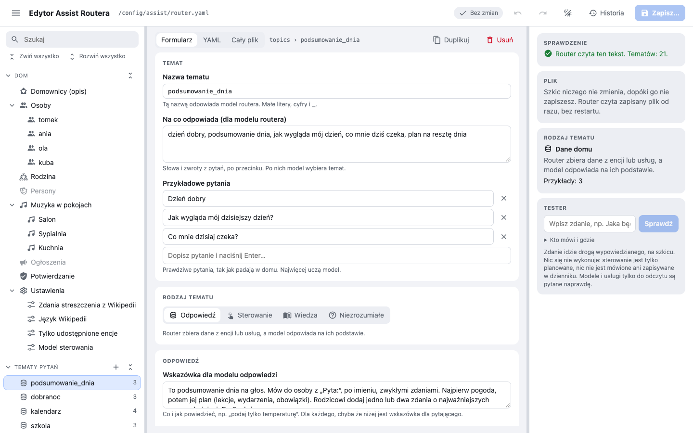
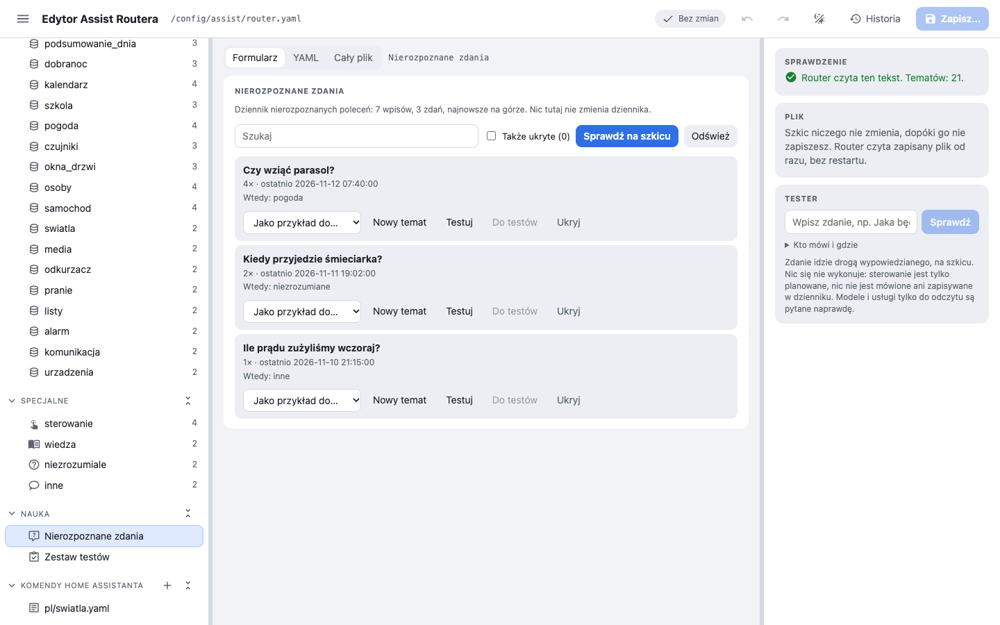
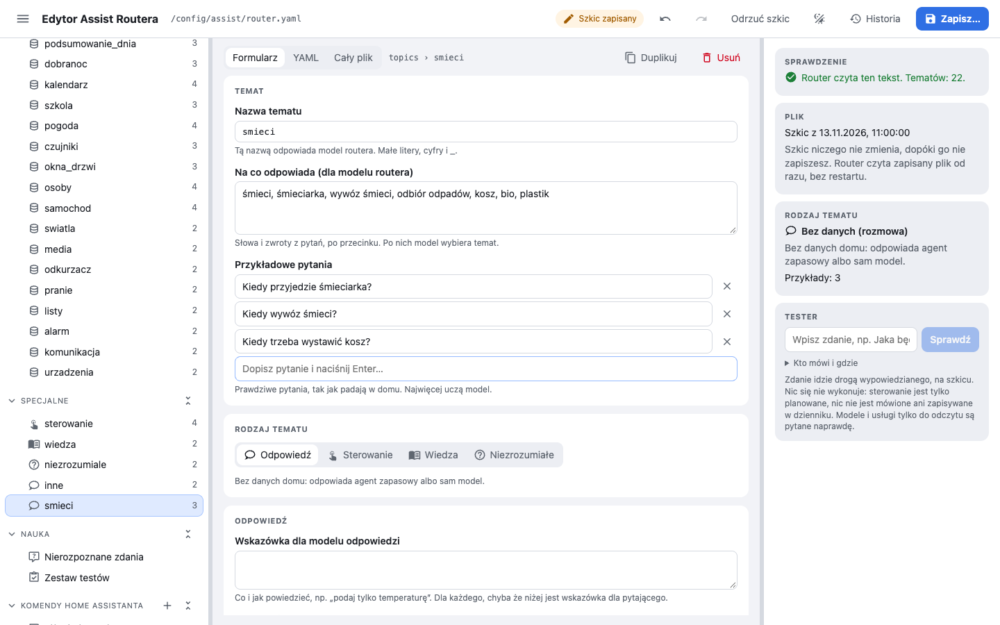
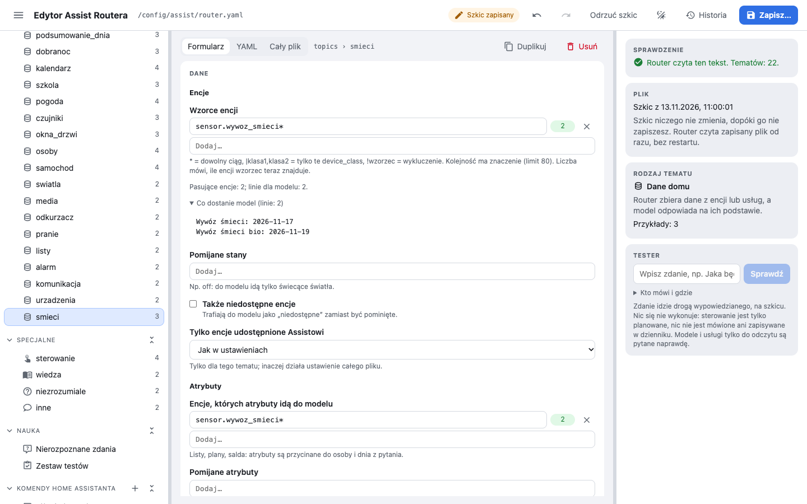
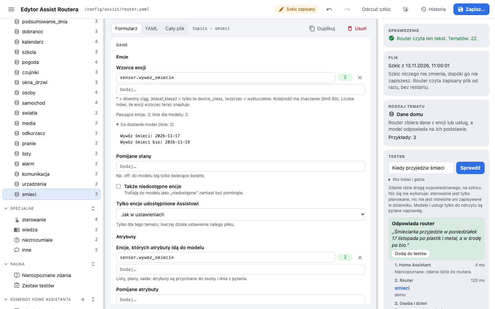
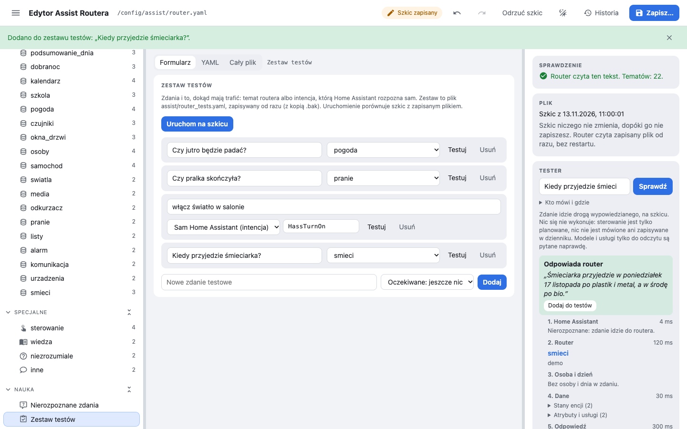
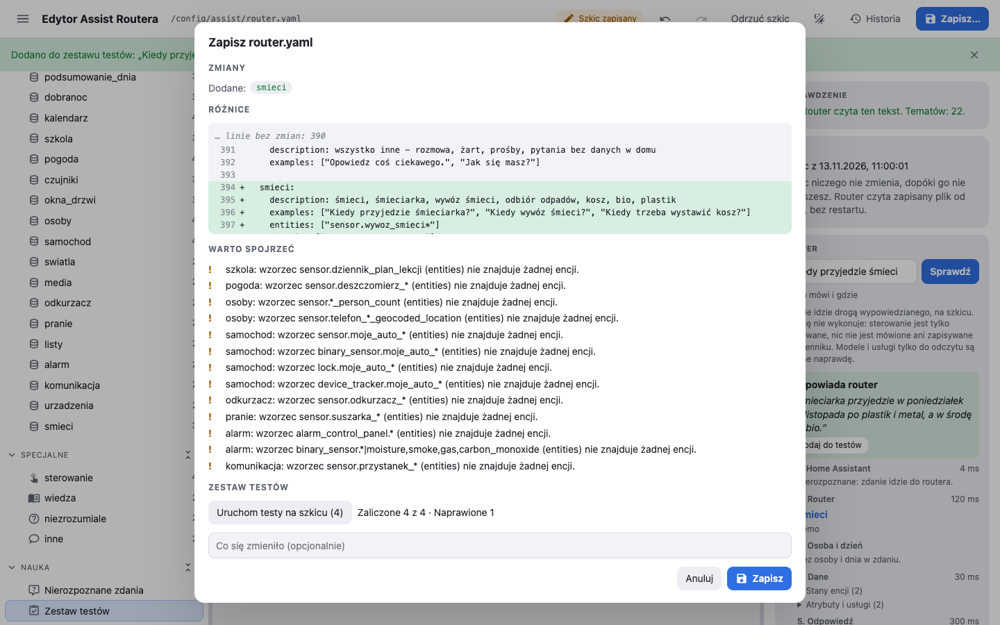
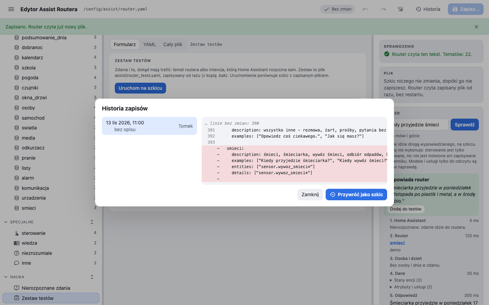
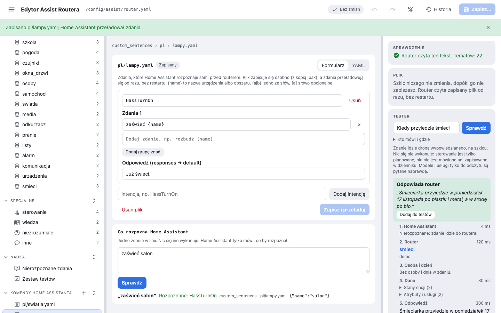

# Edytor krok po kroku

Jak zbudować nową funkcję asystenta bez pisania YAML: od zdania, którego asystent nie zrozumiał, przez nowy temat z danymi, test i zapis, do komendy Home Assistant. Nazwy przycisków i pól są takie jak w edytorze, a zrzuty pochodzą z wersji demonstracyjnej ze zmyślonym domem.

## Zanim zaczniesz {#before}

Edytor to panel w Home Assistant, w którym budujesz to, co umie asystent: tematy pytań z danymi domu i
komendy, które Home Assistant rozpoznaje sam. Nie musisz pisać YAML: każdy element ma formularz, a plik
`router.yaml` zmienia się dopiero po zapisie.

- **Gdzie:** pasek boczny → <b class="ui">Edytor Assist Routera</b>. Panel widzą tylko administratorzy. Gdy jest ukryty
  (opcja <b class="ui">Pokazuj edytor w pasku bocznym</b> w Ustawienia → Urządzenia i usługi → Assist Router → Konfiguruj),
  otworzysz go pod adresem `/assist-router-editor`.
- **Bez Home Assistant:** `make demo` w repozytorium otwiera edytor na przykładowym pliku ze
  zmyślonym domem. Nic się wtedy nie zapisuje. Z tej wersji pochodzą wszystkie zrzuty poniżej.
- **Szkic:** każda zmiana trafia do szkicu zapisanego w Home Assistant. Szkic niczego nie zmienia i czeka,
  także po zamknięciu strony. Cofanie: <kbd>Ctrl</kbd>+<kbd>Z</kbd>, ponawianie: <kbd>Ctrl</kbd>+<kbd>Shift</kbd>+<kbd>Z</kbd>,
  zapis: <kbd>Ctrl</kbd>+<kbd>S</kbd>.

!!! note

    Przykład, który przechodzi przez cały przewodnik: domownicy pytają „Kiedy przyjedzie śmieciarka?”, a
    asystent tego nie rozumie. W kilku krokach powstaje temat `smieci`, który odpowiada z czujnika wywozu
    śmieci, i komenda „zaświeć {name}” dla Home Assistant.

## Ekran edytora {#screen}

Ekran ma trzy kolumny. Ich szerokość zmienisz, przeciągając granicę; dwuklik przywraca pierwotną.

{ .shot loading=lazy }
/// caption
Temat `podsumowanie_dnia` otwarty w formularzu.
///

- **Lewa kolumna, drzewo pliku:**
  - <b class="ui">Dom</b>: domownicy, <b class="ui">Osoby</b>, <b class="ui">Rodzina</b>, <b class="ui">Persony</b>, muzyka, ogłoszenia, potwierdzanie i <b class="ui">Ustawienia</b>
    (wyszarzone części plik jeszcze nie ma, możesz je wypełnić);
  - <b class="ui">Tematy pytań</b> z przyciskiem <b class="ui">+</b> oraz <b class="ui">Specjalne</b> (sterowanie, wiedza, niezrozumiałe, inne);
  - <b class="ui">Nauka</b>: <b class="ui">Nierozpoznane zdania</b> i <b class="ui">Zestaw testów</b>;
  - <b class="ui">Komendy Home Assistanta</b>: pliki `custom_sentences`, z przyciskiem <b class="ui">+</b>.

  Liczba przy temacie to liczba przykładowych pytań. Pole <b class="ui">Szukaj</b> zawęża drzewo.
- **Środek:** zakładki <b class="ui">Formularz</b>, <b class="ui">YAML</b> (tylko ten element, z komentarzami) i <b class="ui">Cały plik</b>;
  po prawej <b class="ui">Duplikuj</b> i <b class="ui">Usuń</b>.
- **Prawa kolumna:** <b class="ui">Sprawdzenie</b> (czy router przeczyta tekst i ile ma tematów), <b class="ui">Plik</b> (stan
  szkicu), <b class="ui">Rodzaj tematu</b> i <b class="ui">Tester</b>.
- **Górny pasek:** stan (<b class="ui">Bez zmian</b> albo <b class="ui">Szkic zapisany</b>), cofnij i ponów, <b class="ui">Odrzuć szkic</b>,
  jasny lub ciemny wygląd, **?** (ten przewodnik w nowej karcie), <b class="ui">Historia</b> i <b class="ui">Zapisz…</b>.
- **Mały ?** nad drzewem, środkiem i prawą kolumną: małe okienko z opisem tego, co robi ta część, bez wychodzenia
  z edytora (Esc albo kliknięcie obok je zamyka); *Więcej w przewodniku* na jego dole otwiera rozdział o niej, w środku
  o tym, co wybrałeś (temat, testy, nauka…). Przewodnik od razu otwiera tylko ? w pasku górnym.
- **Adres** strony zawiera wybrany element (`…#/topics/weather`): skopiowany link albo odświeżenie otwiera edytor na
  nim, gdy plik się wczyta.

## Skąd wziąć pomysł: nierozpoznane zdania {#learning}

Najlepsze nowe funkcje to te, o które domownicy już pytali. Kliknij <b class="ui">Nauka</b> → <b class="ui">Nierozpoznane zdania</b>.

{ .shot loading=lazy }
/// caption
Zdania z dziennika, zgrupowane: ile razy padły, kiedy ostatnio i dokąd trafiły wtedy.
///

- <b class="ui">Sprawdź na szkicu</b> pokazuje, dokąd każde zdanie trafiłoby teraz.
- Przy każdym zdaniu: <b class="ui">Jako przykład do…</b> (dopisuje je do istniejącego tematu), <b class="ui">Nowy temat</b>,
  <b class="ui">Testuj</b> (wstawia je do testera), <b class="ui">Do testów</b> i <b class="ui">Ukryj</b>. Ukrycie działa tylko w edytorze: dziennik
  zostaje bez zmian.

W przykładzie zdanie „Kiedy przyjedzie śmieciarka?” trafiło do tematu „niezrozumiałe”. Kliknij przy nim
<b class="ui">Nowy temat</b>.

## Nowy temat {#topic}

<b class="ui">Nowy temat</b> zakłada temat z tym zdaniem jako opisem i pierwszym przykładem i od razu otwiera jego formularz.
Pusty temat dodaje też <b class="ui">+</b> przy <b class="ui">Tematy pytań</b>.

1. <b class="ui">Nazwa tematu</b>: krótki klucz z małych liter, cyfr i `_`, np. `smieci`. Tą nazwą
   odpowiada model routera. Zmiana nazwy zmienia klucz w pliku.
2. <b class="ui">Na co odpowiada (dla modelu routera)</b>: słowa i zwroty z pytań po przecinku, np. „śmieci, śmieciarka, wywóz
   śmieci, odbiór odpadów, kosz, bio, plastik”. Po nich model wybiera temat, więc wpisz różne sposoby mówienia o tym
   samym.
3. <b class="ui">Przykładowe pytania</b>: wpisz pytanie w <b class="ui">Dopisz pytanie i naciśnij Enter…</b> i naciśnij <kbd>Enter</kbd>.
   Dodaj kilka prawdziwych pytań, tak jak padają w domu: najwięcej uczą model.

{ .shot loading=lazy }
/// caption
Nowy temat z nazwą, opisem i trzema przykładami. Bez danych <b class="ui">Rodzaj tematu</b> to jeszcze <b class="ui">Bez danych (rozmowa)</b>.
///

<b class="ui">Rodzaj tematu</b> ustawiasz przyciskami <b class="ui">Odpowiedź</b>, <b class="ui">Sterowanie</b>, <b class="ui">Wiedza</b> i <b class="ui">Niezrozumiałe</b>.
Pytanie o dane domu to <b class="ui">Odpowiedź</b>. Prawa kolumna pokazuje, jak router widzi temat: po dodaniu danych zmieni się
na <b class="ui">Dane domu</b>.

Niżej, w części <b class="ui">Odpowiedź</b>, są <b class="ui">Wskazówka dla modelu odpowiedzi</b> (np. „podaj dzień tygodnia i rodzaj
śmieci”), <b class="ui">Wskazówki zależne od pytającego (0)</b> (liczba mówi, ile ich jest), <b class="ui">Najdłuższa odpowiedź (tokeny)</b> i <b class="ui">O pytającym</b>.

## Dane tematu {#data}

Temat odpowiada z danych, które mu wskażesz. Przewiń do części <b class="ui">Dane</b>.

1. <b class="ui">Encje</b> → <b class="ui">Wzorce encji</b>: wpisz wzorzec w polu <b class="ui">Dodaj…</b> i naciśnij <kbd>Enter</kbd>, np.
   `sensor.wywoz_smieci*`. Gwiazdka to dowolny ciąg. Zielona liczba obok mówi, ile encji wzorzec znajduje
   teraz; zero jest oznaczone na pomarańczowo.
2. Pod wzorcami: <b class="ui">Pasujące encje: 2; linie dla modelu: 2.</b> Rozwiń <b class="ui">Co dostanie model (linie: 2)</b>, żeby
   zobaczyć dokładnie te linie, które pójdą do modelu.
3. <b class="ui">Atrybuty</b> → <b class="ui">Encje, których atrybuty idą do modelu</b>: wzorce encji (nie nazwy atrybutów), których
   atrybuty mają trafić do modelu, np. ten sam `sensor.wywoz_smieci*`, żeby model znał rodzaj śmieci.
4. <b class="ui">Usługi</b> → <b class="ui">Dodaj usługę</b>: dane z usługi, która je zwraca, np. `calendar.get_events`.
   Usługi nie są wywoływane podczas pisania; robi to dopiero <b class="ui">Pobierz dane teraz</b>, i tylko usługi, które wyłącznie
   zwracają dane.

{ .shot loading=lazy }
/// caption
Wzorzec znajduje 2 encje, a podgląd pokazuje 2 linie dla modelu. Rodzaj tematu zmienił się na <b class="ui">Dane domu</b>.
///

!!! tip

    Liczba 0 przy wzorcu to najczęstszy błąd: wzorzec nie pasuje do żadnej encji (literówka, inna
    domena) albo w polu <b class="ui">Encje, których atrybuty idą do modelu</b> wpisano nazwę atrybutu zamiast wzorca encji.

## Tester {#tester}

Tester puszcza zdanie drogą wypowiedzianego, na szkicu, czyli bez zapisu. Wpisz zdanie w prawej kolumnie
(<b class="ui">Tester</b>) i kliknij <b class="ui">Sprawdź</b>.

{ .shot loading=lazy }
/// caption
<b class="ui">Odpowiada router</b>: temat `smieci` i odpowiedź modelu; niżej kolejne kroki drogi.
///

1. <b class="ui">1. Home Assistant</b>: czy HA rozpoznaje zdanie sam. Rozpoznane kończy drogę.
2. <b class="ui">2. Router</b>: wybrany temat (kliknięcie otwiera go w formularzu), model i czas.
3. <b class="ui">3. Osoba i dzień</b> wyciągnięte ze zdania.
4. <b class="ui">4. Dane</b>: stany encji, atrybuty i usługi, które dostał model.
5. <b class="ui">5. Odpowiedź</b> modelu z czasem; <b class="ui">Prompt</b> da się rozwinąć.

<b class="ui">Kto mówi i gdzie</b> ustawia mówcę, personę, pokój i porównanie z zapisanym plikiem. Tester niczego nie robi
w domu: sterowanie jest tylko planowane, nic nie jest mówione ani zapisywane w dzienniku. Naprawdę pytane są modele
i usługi, które tylko zwracają dane.

Gdy router wybiera zły temat, popraw <b class="ui">Na co odpowiada (dla modelu routera)</b> albo dopisz przykład i sprawdź
ponownie.

## Zestaw testów {#tests}

Działające zdanie warto zapamiętać, żeby kolejna zmiana go nie popsuła. W testerze kliknij <b class="ui">Dodaj do testów</b>.
Zestaw jest w <b class="ui">Nauka</b> → <b class="ui">Zestaw testów</b> (plik `assist/router_tests.yaml`, zapisywany od razu,
z kopią `.bak`).

{ .shot loading=lazy }
/// caption
Każdy test to zdanie i to, dokąd ma trafić: temat routera albo intencja, którą Home Assistant rozpozna sam.
///

- <b class="ui">Uruchom na szkicu</b> sprawdza każde zdanie na szkicu i na zapisanym pliku.
- Nowy test: <b class="ui">Nowe zdanie testowe</b>, cel z listy (temat albo <b class="ui">Sam Home Assistant (intencja)</b>) i <b class="ui">Dodaj</b>.
- <b class="ui">Testuj</b> wstawia zdanie do testera, <b class="ui">Usuń</b> usuwa test.

## Zapis {#save}

Kliknij <b class="ui">Zapisz…</b> na górze. Okno <b class="ui">Zapisz router.yaml</b> pokazuje wszystko, zanim plik się zmieni:

{ .shot loading=lazy }
/// caption
Zmiany, różnice, ostrzeżenia i wynik testów na szkicu.
///

- <b class="ui">Zmiany</b>: elementy dodane, usunięte i zmienione; <b class="ui">Różnice</b>: zmienione linie pliku.
- <b class="ui">Warto spojrzeć</b>: wzorce, które nic nie znajdują, usługi, które mogą coś zmienić albo których nie ma,
  tematy bez opisu lub przykładów. Ostrzeżenia nie blokują zapisu. W pliku przykładowym są ostrzeżenia dla encji,
  których zmyślony dom nie ma.
- <b class="ui">Zestaw testów</b>: <b class="ui">Uruchom testy na szkicu (4)</b> pokazuje, ile testów przeszło i ile zmiana naprawiła
  albo popsuła.
- <b class="ui">Co się zmieniło (opcjonalnie)</b>: opis wersji do historii. Potem <b class="ui">Zapisz</b>.

Edytor nie zapisze tekstu, którego router nie przeczyta. Router czyta zapisany plik od razu, bez restartu, a
poprzedni zostaje jako `router.yaml.bak`.

## Historia i cofanie {#history}

<b class="ui">Historia</b> na górze otwiera <b class="ui">Historia zapisów</b>: ostatnie 30 zapisów z datą, opisem i autorem.
Wybrana wersja pokazuje różnice wobec obecnego pliku.

{ .shot loading=lazy }
/// caption
Wersja sprzed zapisu: przywrócenie usunęłoby temat `smieci` (linie na czerwono).
///

<b class="ui">Przywróć jako szkic</b> wczytuje tę wersję do szkicu; plik zmieni się dopiero po zapisie. Przed zapisem całe
zmiany odrzuca <b class="ui">Odrzuć szkic</b>.

## Komenda Home Assistant {#command}

Nie każde zdanie potrzebuje routera. Proste polecenia Home Assistant rozpozna sam, szybciej i bez modelu, jeśli
dodasz je do `custom_sentences`. Takie pliki są w grupie <b class="ui">Komendy Home Assistanta</b>.

1. <b class="ui">+</b> przy <b class="ui">Komendy Home Assistanta</b>. Przeglądarka zapyta o nazwę pliku
   („Nazwa nowego pliku w custom_sentences (litery, cyfry, _ i -):”), np. `lampy.yaml`.
2. Wpisz intencję w <b class="ui">Intencja, np. HassTurnOn</b> i kliknij <b class="ui">Dodaj intencję</b>. Wbudowane intencje Home
   Assistant (np. `HassTurnOn`, `HassTurnOff`) działają od razu.
3. W <b class="ui">Zdania 1</b> wpisz zdanie w <b class="ui">Dodaj zdanie, np. rozbudź {name}</b> i naciśnij <kbd>Enter</kbd>, np.
   `zaświeć {name}`. `{name}` to nazwa urządzenia albo obszaru, `(a|b)` jedno ze
   słów, `[a]` słowo opcjonalne. <b class="ui">Dodaj grupę zdań</b> zakłada kolejną grupę.
4. <b class="ui">Odpowiedź (responses → default)</b>: co Home Assistant powie, np. „Już świeci.”. Puste = odpowiedź Home
   Assistanta.
5. <b class="ui">Zapisz i przeładuj</b>: sprawdza każde zdanie tak jak Home Assistant, zapisuje plik z kopią `.bak`
   i przeładowuje zdania, więc komenda działa od razu, bez restartu.
6. <b class="ui">Co rozpozna Home Assistant</b>: wpisz zdanie, np. „zaświeć salon”, i kliknij <b class="ui">Sprawdź</b>. Nic się nie
   wykonuje: Home Assistant tylko mówi, co by rozpoznał.

{ .shot loading=lazy }
/// caption
Plik `pl/lampy.yaml` zapisany i przeładowany; „zaświeć salon” → <b class="ui">Rozpoznane: HassTurnOn</b> z `name` = salon.
///

!!! tip

    Intencja, której Home Assistant nie umie wykonać (nie jest wbudowana ani nie ma `intent_script`),
    jest oznaczona: zdanie zostanie rozpoznane, ale nic się nie stanie.

Plik komend zapisuje się osobno, nie razem ze szkicem `router.yaml`. <b class="ui">Usuń plik</b> odkłada go jako
`.bak`.

## Wszystkie części edytora {#editor}

!!! tip

    **Krok po kroku ze zrzutami ekranu:** [Edytor Assist Routera
    krok po kroku](#before) (początek tej strony) pokazuje na przykładzie, jak zbudować nową funkcję: od nierozpoznanego zdania, przez nowy temat z
    danymi, tester i zapis, do komendy Home Assistant. Niżej jest opis wszystkich części edytora.

Integracja dodaje do paska bocznego Home Assistant panel dla administratorów:
**Edytor Assist Routera**. Opcja *Pokazuj edytor w pasku bocznym* (Konfiguruj → Ustawienia)
chowa go z paska; wtedy otwiera się pod adresem `/assist-router-editor`. Edytor ma jasny i ciemny wygląd:
domyślnie taki jak Home Assistant, a przycisk w górnym pasku przełącza Auto, Jasny i Ciemny (przeglądarka to
pamięta). Edytuje `router.yaml` w
trzech kolumnach:

- **drzewo** pliku: dom (domownicy, osoby, rodzina, persony, muzyka, ogłoszenia,
  potwierdzanie, ustawienia; części, których plik jeszcze nie ma, są wyszarzone i można je wypełnić),
  tematy pytań i tematy specjalne (sterowanie, wiedza, niezrozumiałe zdania, bez
  danych). Temat bez opisu albo bez przykładów jest oznaczony. Wyszukiwarka zawęża drzewo, a całe
  drzewo można zwinąć i rozwinąć (grupy zostają otwarte). Strzałka przy nazwie grupy zwija samą grupę, a ikona po
  jej prawej zwija albo rozwija wszystko w środku tej grupy;
- **formularz** zaznaczonego elementu (opis niżej), jego **YAML** razem z komentarzami tuż nad jego kluczem albo cały
  plik. Zmieniają się tylko linie tego elementu: wszystkie inne linie, komentarze i układ zostają
  bez zmian. Nowy klucz zmienia nazwę elementu. Tekst, który nie jest jeszcze poprawnym YAML,
  czeka, a edytor pokazuje powód;
- **sprawdzenie**: czy router czyta tekst i ile znajduje tematów oraz jakiego rodzaju
  jest zaznaczony temat, a pod nim **tester** (opis niżej).

Każda zmiana trafia do **szkicu** zapisanego w HA (`.storage/assist_router.editor`).
Szkic niczego nie zmienia, dopóki go nie zapiszesz, i czeka po zamknięciu strony. Cofanie i ponawianie
obejmuje całą sesję (Ctrl+Z i Ctrl+Shift+Z poza polem tekstowym; Ctrl+S otwiera zapis).
**Zapisz…** pokazuje, co się zmienia (elementy dodane, usunięte i zmienione oraz różne
linie), nie zapisze tekstu, którego router nie przeczyta, i zatrzymuje się, gdy plik zmienił się poza
edytorem od początku szkicu; *Zapisz mimo to* nadpisuje tamte zmiany. Poprzedni plik zostaje
jako `router.yaml.bak` i w **historii** ostatnich 30 zapisów. Każdą wersję można
przywrócić jako szkic. Router czyta zapisany plik od razu, bez restartu.

Temat dodaje **+** przy „Tematy pytań”; zaczyna się od opisu i przykładu do uzupełnienia.
Element można zduplikować (razem z komentarzami) i usunąć.

**Formularze.** Element otwiera się w formularzu. Zakładka *YAML* pokazuje to samo
jako tekst, a edytor pamięta, którą zakładkę wybrałeś. Formularz zmienia tylko linie jednego pola, w stylu,
którego plik już używa: lista w nawiasach zostaje w nawiasach, lista w liniach zostaje w liniach razem z
komentarzami przy elementach, a komentarz na końcu linii zostaje na swoim miejscu. Długi tekst jest zawijany
(`>-`). Wartości są zapisywane tak, jak czyta je router: „tak”, „yes” albo „08” trafiają w
cudzysłowie, więc zostają tekstem. Tekst ze znakiem `?` albo `:` w liście w nawiasach
też dostaje cudzysłów: router czyta `[Czy będzie padać?]` jako błąd („expected ',' or ']', but got
'?'”), a `["Czy będzie padać?"]` poprawnie. Puste pole znika z pliku po wyjściu z niego.

- **Temat:** nazwa, opis dla modelu routera, przykładowe pytania i rodzaj (odpowiedź,
  sterowanie, wiedza, niezrozumiałe). Temat z odpowiedzią ma też wskazówkę dla modelu odpowiedzi,
  wskazówki dla rodzica, dziecka, dziewczynki, chłopca, nierozpoznanego mówcy i pojedynczych osób,
  długość odpowiedzi, „o pytającym” (`personal`), dzień domyślny (`days`), pomijane
  stany i atrybuty, niedostępne encje i `only_exposed`.
- **Źródła danych tematu z podglądem na żywo.** Przy każdym wzorcu encji
  (`entities`, `details`, encje usług) liczba mówi, ile encji znajduje teraz
  (najechanie pokazuje pierwsze z nich, a zero jest oznaczone). Pod wzorcami: ile encji pasuje, ile linii
  dostanie model i same te linie, policzone tym samym kodem co przy pytaniu (bez osoby i dnia), oraz
  ostrzeżenie, gdy pasuje więcej niż 80 encji. Atrybuty z `details` są pokazane tak, jak idą do
  modelu. Usługi z odpowiedzią (`fetch`) mają własne karty: usługa (podpowiedzi to tylko usługi,
  które wyłącznie zwracają dane), encje, nagłówek, łączenie listy, limit, to, co już minęło, i dane usługi
  w YAML. Usługi nie są wywoływane podczas pisania: robi to dopiero przycisk *Pobierz dane teraz*, i
  to wyłącznie usługi, które tylko zwracają dane. Usługę, która może coś zmienić, edytor oznacza, a router
  i tak nigdy jej nie wywoła. Zdanie z `command` nie jest wysyłane do HA. Frigate i komendę
  edytuje się w zakładce YAML.
- **Osoby:** lista z dodawaniem po imieniu (klucz powstaje z imienia, np. „Łucja” →
  `lucja`). Osoba: imię, wzorzec `match` z próbą na zdaniu, głos w Assist Speaker ID,
  pokój (podpowiedzi z obszarów HA), jej encje i etykiety. Osoba zapisana samym imieniem
  (`ola: Ola`) dostaje pola w osobnych liniach.
- **Rodzina:** rodzice, dzieci oraz mężczyźni i chłopcy do zaznaczenia spośród osób.
- **Persony:** nazwa, prompt, forma (męska, żeńska), potoki i głosy TTS (podpowiedzi z potoków
  Assist). Brak promptu albo potoku i głosu jest oznaczony, bo wtedy router nie czyta pliku.
- **Muzyka w pokojach, ogłoszenia, potwierdzanie:** listy odtwarzaczy i encji z
  podpowiedziami z HA. Pusta lista odtwarzaczy pokoju zostaje w pliku (w tym pokoju nie ma muzyki).
- **Ustawienia:** język, zdania streszczenia z Wikipedii, język Wikipedii,
  `only_exposed`, model sterowania oraz prompty odpowiedzi i streszczeń. Słowo w klamrach inne
  niż `{household}`, `{now}` i `{sentences}` jest oznaczone, bo router
  nie umie go wypełnić.

**Tester.** Wpisane zdanie przechodzi drogę wypowiedzianego, **na szkicu**, czyli
bez zapisu. Kolejne kroki to:

1. **Home Assistant**: czy wbudowany agent albo `custom_sentences` rozpoznaje zdanie
   (debugowanie zdań HA, które niczego nie wykonuje). Zdanie rozpoznane przez HA kończy drogę;
2. **router**: wybrany temat (kliknięcie otwiera go w formularzu), model i czas. Z opcją
   porównania także temat, który wybrałby zapisany plik;
3. **osoba i dzień** wyciągnięte ze zdania;
4. **dane** (linie stanów, atrybuty, usługi) albo **plan sterowania** (intencja,
   sloty, czy by wykonał, czy najpierw zapytał);
5. **odpowiedź** modelu z czasem; prompt można rozwinąć.

Zdanie z kilkoma poleceniami jest rozbite, a każde polecenie ma swoją drogę. Opcje: kto mówi, persona, pokój
mówcy, porównanie z zapisanym plikiem, pominięcie HA i odpowiedź bez modelu odpowiedzi. Ostatnie 10 zdań
podpowiada pole testera. **Tester niczego nie robi:** sterowanie jest tylko planowane, zdanie z
`command` jest tylko rozpoznawane (wysłane mogłoby uruchomić automatyzację), agent zapasowy nie jest
pytany, nic nie jest mówione ani ogłaszane i nic nie trafia do dziennika nierozpoznanych. Naprawdę pytane są
modele Ollamy oraz usługi, które tylko zwracają dane, tak jak przy prawdziwym pytaniu.

**Nauka** (grupa w drzewie) ma dwa widoki.

- **Nierozpoznane zdania** z `assist/unrecognized_commands.csv`, zgrupowane po zdaniu
  (wielkość liter i znak na końcu nie mają znaczenia): ile razy padło, kiedy ostatnio, kto i gdzie mówił, jak
  poszło wtedy. *Sprawdź na szkicu* pokazuje, dokąd każde zdanie trafiłoby teraz (HA albo temat
  routera). Zdanie można dodać jako przykład do tematu, zrobić z niego nowy temat (opis i pierwszy przykład),
  przetestować w testerze, dodać do testów albo ukryć. Ukrycie działa tylko w edytorze: dziennik zostaje bez
  zmian.
- **Zestaw testów** w `assist/router_tests.yaml`: zdanie i to, dokąd ma trafić,
  czyli temat routera albo intencja, którą HA rozpozna sam. Zestaw zapisuje się od razu (z kopią
  `.bak`), bo nie jest częścią `router.yaml`. *Uruchom na szkicu* sprawdza każde
  zdanie na szkicu i na zapisanym pliku i pokazuje, ile testów przeszło, a ile zmiana naprawiła albo popsuła.
  Test dodaje też przycisk *Dodaj do testów* w testerze.

**Komendy Home Assistanta** (grupa w drzewie) to pliki `custom_sentences/<język>/*.yaml`:
zdania, które Home Assistant rozpoznaje sam, zanim zdanie trafi do routera. Plik otwiera się w formularzu
(intencje, ich zdania i odpowiedź) albo jako YAML. Zdanie pisze się jak w HA: `{name}` to nazwa urządzenia
albo obszaru, `(a|b)` jedno ze słów, `[a]` słowo opcjonalne. Intencja, której HA nie umie
wykonać (nie jest wbudowana ani nie ma `intent_script`), jest oznaczona: zdanie zostanie rozpoznane, ale nic
się nie stanie. *Zapisz i przeładuj* sprawdza każde zdanie tak jak HA (zła składnia nie trafi do pliku),
zapisuje plik z kopią `.bak` i przeładowuje zdania usługą `conversation.reload`, więc nowa komenda
działa od razu, bez restartu. Plik zapisuje się osobno, nie ze szkicem `router.yaml`. *Co rozpozna Home
Assistant* sprawdza wpisane zdania na zapisanych plikach i niczego nie wykonuje. **+** przy grupie
zakłada nowy plik, a *Usuń plik* odkłada go jako `.bak`.

**Przed zapisem** okno *Zapisz…* pokazuje oprócz zmian i różnic:

- **Warto spojrzeć**: wzorce encji, które nic nie znajdują, usługi, które mogą coś zmienić albo
  których nie ma, tematy bez opisu lub przykładów oraz słowa w klamrach promptu, których router nie wypełni.
  Ostrzeżenia nie blokują zapisu;
- **Zestaw testów**: przycisk uruchamia testy na szkicu i porównuje je z zapisanym plikiem. Okno
  mówi, ile testów zmiana popsuła, i wymienia niezaliczone. Ostrzega też, gdy testy oczekują tematu, którego
  szkic już nie ma. Zapisać można mimo to.
